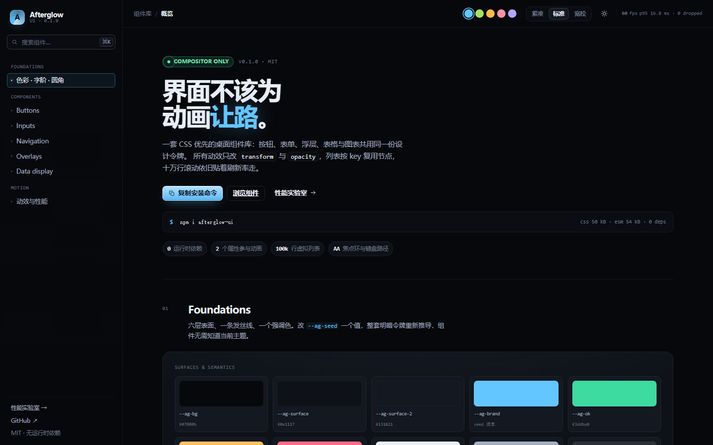

# Afterglow UI



给桌面监控类应用做的 UI 组件库：**零运行时依赖、CSS 优先、高频动效只碰合成层**。
按钮、表单、浮层、表格、环形仪表、滚动数字与虚拟列表共用一份设计令牌，明暗主题与强调色由种子色推导。

- 在线画廊：<https://weidows.github.io/afterglow-ui/>
- 在线性能实验室：<https://weidows.github.io/afterglow-ui/bench.html>
- 本地：`npm run dev` → <http://127.0.0.1:5180/>
- 仓库：<https://github.com/Weidows/afterglow-ui>

浅色主题预览：[docs/preview-light.png](docs/preview-light.png)

## 为什么再造一套

现有 MyGo 生态的组件库大多把交互与样式绑死在框架里；这个程序（Cacab）的页面是
`innerHTML` 模板 + 每秒重绘，套组件等于每次重建状态。Afterglow 把两件事拆开：

1. **样式是纯 CSS**：`class` + `data-*` 属性直接出效果，重绘一万次也不掉状态；
2. **行为是按需增强的 TS 模块**：选择器、滑块、标签页、浮层、toast 才需要 JS，原生控件语义不变。

动效契约（不是口号，实验室里可测）：

- 高频动效——列表滚动、指示块、进度条、滚动数字——只允许 `transform` 与 `opacity`；没有 `width/top/left` 过渡；
- 颜色、边框、模糊等低频小面积过渡可以有，但不进入滚动与逐帧路径；环形仪表的渐变每秒重绘一次；
- 曲线是弹簧方程采样出的 CSS `linear()`（k / c 见 `tokens.css`），不是猜的贝塞尔；
- 列表按 key 复用节点，虚拟列表只挂可见窗口，滚出的行回收到池里；
- 浮层全部进浏览器顶层（`<dialog>` / popover API），不参与 z-index 战争；
- `prefers-reduced-motion: reduce` 下全部压到 0.01 ms。

## 安装

```bash
npm i afterglow-ui
```

```ts
import "afterglow-ui/style.css";
import { toast, bindDialog, enhanceSelects } from "afterglow-ui";
```

> 样式是独立文件，**必须显式引入一次**（或在你自己的 CSS 里 `@import "afterglow-ui/style.css"`）。
> 发布体积：CSS 50 kB（gzip 9.7 kB）、ESM 54 kB（gzip 15.6 kB），无运行时依赖。

## 快速开始

```html
<!-- 纯 CSS：不需要一行 JS -->
<button class="ag-btn" data-variant="primary">开始加速</button>
<button class="ag-btn" data-variant="danger">强制停止</button>

<div class="ag-card">
  <div class="ag-card__head"><h3 class="ag-card__title">L2 缓存</h3></div>
  <div class="ag-meter"><div class="ag-meter__track">
    <div class="ag-meter__fill" style="--ag-v:.62"></div>
  </div><span class="ag-meter__value">62%</span></div>
</div>
```

```ts
import { toast, bindDialog, enhanceSelects, enhanceRanges, tabs } from "afterglow-ui";

enhanceSelects(document);   // select.ag-select → 自定义列表（原生语义保留）
enhanceRanges(document);    // input.ag-range → 填充轨道 + 数值气泡
bindDialog(document.querySelector("#confirm")!); // 背景点击 / Esc / [data-dialog-close]
tabs(document.querySelector("#views")!);         // 共享指示块 + roving tabindex

toast("磁盘 3 已重新联机", { tone: "ok", duration: 4000 });
```

主题：`<html data-ag-theme="light">`，品牌色 `<html data-ag-brand="mint">`（cyan / lime / amber / rose / violet / mint），
密度 `applyDensity("compact" | "default" | "comfortable")`。

## 组件

| 分类 | 组件 | 用法 |
|---|---|---|
| Actions | Button、Icon button、Tooltip | 纯 CSS（`ag-btn` / `ag-iconbtn` / `data-tip`） |
| Forms | Input、Textarea、Field、Switch、Checkbox、Radio、Range、Select | CSS；Select / Range 可渐进增强 |
| Navigation | Tabs、Segmented | CSS + `tabs()` / `segmented()` 指示块 |
| Overlays | Dialog、Popover、Menu、Toast | `bindDialog` / `openPopover` / `menu` / `toast` |
| Display | Card、Badge、Tag、Kbd、Status、Avatar、Meter、Ring、NumberFlow、Sparkline、Skeleton、Spinner | 除 NumberFlow / Sparkline 外纯 CSS |
| Data | Table、VirtualList | `.ag-table` CSS；`new VirtualList()` |
| Core | `signal` / `computed` / `effect`、`KeyedList`、`springEasing`、`icon()` | 可选，不引入也能用 |

## 性能实验室

`npm run dev` 后打开 `/bench.html`，同一页跑 100,000 行虚拟列表（20 Hz 数据流）、
240 个 60 Hz 仪表、以及「2,000 行整表重建 vs 键控复用」对比。

一台 Windows 11 / Edge 1440×1000（headless，`--disable-gpu`）的实测：

| 项目 | 结果 |
|---|---|
| 帧率 / p95 | 60 fps · 16.8 ms |
| dropped（>1.5× 中位帧） | 2 / 240 帧 |
| 2,000 行整表重建 | 3.87 ms / 轮 |
| 2,000 行键控复用 | 0.87 ms / 轮 |
| 差值 | **4.4×** |

复现：`npm run dev` → 打开 `/bench.html` → 点「跑 10 轮」。数字随机器变化，脚本耗时是重点。

## 开发

```bash
npm install
npm run dev         # 画廊 + 热更新（127.0.0.1:5180）
npm run typecheck
npm test            # 响应式内核 / LIS / 弹簧曲线
npm run build       # dist/index.js + dist/afterglow.css + 类型声明
npm run build:gallery
```

目录：

```
src/
  core/         signal / keyed / spring / raf / dom / icons / theme
  components/   toast dialog popover menu tabs segmented select slider tooltip
                virtual-list sparkline number-flow
  styles/       tokens base utilities forms surfaces nav data motion
gallery/        画廊与性能实验室（Vite 入口，不随库发布）
test/           内核单元测试（vitest，node 环境）
```

## 设计约束

- 暗色优先；浅色是同一套令牌的第二套值，组件不写主题分支。
- 浮层依赖 popover API 与原生 `<dialog>`（Chromium 114+ / WebView2 同期）。
- 虚拟列表是固定行高；变高行请先用两层：外层窗口 + 内层 `content-visibility`。
- 表格不接管数据与排序，只提供密度、粘性表头、数字对齐与选中态样式。
- 没有内置图标集之外的第二套图标；`icon()` 输出的是受信任的静态 SVG，**不要传用户内容**。

## License

MIT © 2026 Weidows
